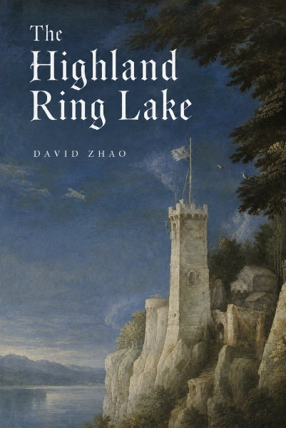

  

  <strong>UBC Master of Data Science · Vancouver, BC · Authorized to work in Canada</strong>

  &nbsp;&nbsp;&nbsp;
  &nbsp;&nbsp;&nbsp;
  

## Focus

I use **Python and SQL** to build data pipelines, evaluate predictive models, investigate business performance, and turn analytical results into dashboards and decision tools. My work spans **data science, analytics engineering, machine learning validation, and risk analytics**.

My recent projects include a **pandas/NumPy validation pipeline for approximately 438,000 breast screening exams**, **logistic regression and LightGBM model updating**, and a **SQL/Python fraud-policy analysis with an interactive scenario explorer**. Earlier work at **Ping An Finserve** combined operational analytics, KPI reporting, A/B testing, and product management for nationwide financial systems.

My background spans **industrial design, product management, and data science**. I connect analytical work with its practical use: defining metrics, structuring data, evaluating interventions, designing operational workflows, and building tools that help people explore and act on results.

**Python · SQL · R · pandas · NumPy · scikit-learn · LightGBM · Power BI · Tableau · Git**

| Capability | Methods and tools |
| --- | --- |
| **Programming & data preparation** | Python/pandas/NumPy, R, SQL joins, CTEs, window functions and query optimization; cleaning, integration, cohort construction and feature engineering |
| **Machine learning & validation** | scikit-learn, logistic regression, LightGBM, ROC AUC, Brier score, calibration, external and temporal validation, leakage auditing |
| **Statistics & experimentation** | A/B testing, hypothesis testing, confidence intervals, intent-to-treat analysis, patient-cluster bootstrap, subgroup and sensitivity analysis |
| **BI & operational analytics** | Power BI (DAX, Power Query), Tableau, Excel (PivotTables, XLOOKUP), KPI dashboards, scheduled reporting and capacity monitoring |
| **Data platforms & modeling** | MySQL, dbt, Snowflake, Databricks, Azure, Microsoft Fabric; relational and dimensional modeling, ETL/ELT and data warehousing |
| **Reproducible analytical systems** | Git, Jupyter, automated tests, GitHub Actions, documented pipelines, structured result tables, source provenance and reconciliation |

## Selected Work

### Healthcare Risk Model Validation

**Python · pandas · NumPy · scikit-learn · LightGBM · Model calibration · Temporal validation**

Breast cancer risk-model validation originating from my **BC Cancer / UBC MDS capstone**, with later independent extensions. The retrospective analysis covered up to **438,571 eligible screening exams** across **1–5 year cumulative risk horizons**.

I built a **Python preprocessing and validation pipeline using pandas and NumPy**, constructing patient-level cohorts and splits, cumulative outcomes, and follow-up eligibility controls. The workflow evaluated discrimination and calibration using ROC AUC, Brier score, expected-to-observed ratio, and calibration slope/intercept, with structured tables and visualizations prepared for clinical and biostatistical review.

I independently extended the work through **feature engineering and prediction-level model updating using logistic regression and LightGBM**. Exploratory patient-level held-out AUCs reached **0.774–0.835**; future-period testing narrowed gains over Original Mirai to **0.007–0.017**. Patient-cluster bootstrap, first-exam sensitivity analysis, and feature-availability audits examined uncertainty, repeated observations, and prediction-time leakage.

The public repository combines aggregate project evidence with a **runnable synthetic reconstruction**, modular analysis code, automated tests, and GitHub Actions that run the tests and complete pipeline.

**[Explore the repository →](https://github.com/gugujilulu/healthcare-risk-model-validation)**

### Fraud Policy Decision Science

**SQL · Python · Cohort analysis · Intent-to-treat evaluation · Policy simulation**

An independent simulated case study investigating a fraud loss-rate increase from **0.32% to 0.47%**. The analysis connects payment routing and randomized authentication with transaction completion, cross-channel fraud displacement, and recovery congestion.

I built **SQL cohort analyses using CTEs and conditional aggregation**, alongside Python simulations, to distinguish changes in risk from loss-recognition timing and incomplete follow-up. **Intent-to-treat evaluation** measures authentication effects across all assigned attempts, including transactions that are abandoned or declined.

The interactive **Policy Lab** contains **135 precomputed scenarios**, comparing authentication policies under different recovery capacities, evidence delays, and displacement assumptions. The analysis also identifies conditions where adaptive rules tie or underperform fixed policies.

The repository includes a **packaged Python analysis, configuration-driven execution, automated tests, dependency locks, and GitHub Actions** that rebuild and validate the outputs. Tests check experimental estimators, queue balances, capacity constraints, and financial accounting identities.

**[Explore the case study](https://github.com/gugujilulu/fraud-policy-decision-science) · [Open Policy Lab](https://fraud-policy-lab.gugu4-5.chatgpt.site)**

### Central Asian Square-Hole Coinage Atlas

**Python · SQL/SQLite · React · TypeScript · MapLibre GL · Data provenance**

An independent digital heritage project making Sogdian and Central Asian coinage accessible through a multilingual map and searchable catalogue. I designed and developed the platform, connecting **56 editorial coin families and 1,010 source records** with photographs, historical geography, and traceable sources in **English, Chinese and Russian**.

The data workflow uses **Python collection, validation, and export scripts**, a **relational SQLite research model**, and a normalized JSON export for the application. It handles stable identifiers, source-identity reconciliation, image provenance, and relationships between physical specimens, source records, editorial classifications, and historical locations.

The application uses **React, TypeScript, and MapLibre GL** for combined search and filtering, geographic exploration, image viewing, multilingual navigation, and responsive detail panels. My knowledge of ancient coins informs the data model, source interpretation, and presentation of uncertain or competing attributions.

Alongside an invitation to speak on Sogdian numismatics at a **Vancouver coin club**, I’m seeking specialist feedback and exploring collaboration with **Zeno and cultural institutions in China**. The project supports cultural education and comparative research, with the aim of contributing to numismatics in Canada.

**[Explore the repository](https://github.com/gugujilulu/Sogdian-coins-website) · [Open the live atlas](https://sogdian-cash-atlas.gugu4-5.chatgpt.site)**

### Risk Operations & Analytics Systems — Ping An Finserve

**KPI dashboards · Reporting automation · A/B testing · Workflow digitization · Strategy systems**

As a **Product Manager in the Risk Asset Management Center**, I worked on **CMP2.0** and **Tianshu**, supporting nationwide collection operations across credit-card, consumer-loan, retail-finance, and mortgage portfolios.

I led the cross-business rollout of **CMP2.0**, migrating collection workflows from spreadsheets into a centralized platform. The work included automated operational logging, differentiated workflows across business lines, intelligent dialing strategies, and **Sensors Data Analytics dashboards**. Digitized workflows saved approximately **two hours per collector per day** and reduced customer complaints by **50%**.

I built **business intelligence dashboards and automated scheduled reporting**, defining KPIs for performance, compliance, and capacity monitoring and delivering customized reports for credit-card and mortgage operations. I also conducted **A/B testing of customer-service changes** to inform product iteration.

For **Tianshu**, I translated collection strategies into system requirements and execution rules, designing tag libraries, permission models, and strategy-management modules supporting calls, SMS, and intelligent dialing. This work connects my current analytical projects with experience delivering systems used in day-to-day financial operations.

## Professional Context

**Healthcare & ML validation** — Python data preparation, cohort construction, calibration, feature engineering, model updating, robustness and temporal validation  
**Risk & operational analytics** — SQL cohort analysis, experimentation, KPI dashboards, automated reporting and financial decision workflows  
**Platform product systems** — requirements and workflow design at Ping An Finserve, Qunar and Lilith Games, spanning financial operations, international flight booking and live-game administration

## Writing

<table>
<tr>
<td width="170" valign="top">

</td>

<td valign="center">
<h3>The Highland Ring Lake</h3>

I’m writing a fantasy novel in Chinese, with an English excerpt shared here.
Two young runaways follow an ancient aqueduct into the mist, through a world of moss sheep, ruined towers and dark humor.

<strong>
<a href="https://gugujilulu.github.io/gugujilulu/writing/Highland_Ring_Lake_excerpt.pdf">
Read the excerpt · PDF
</a>
</strong>

</td>
</tr>

<tr>
<td width="170" valign="top">

</td>

<td valign="center">
<h3>Sporestar II</h3>

Another ongoing science-fiction novel in Chinese, with an English excerpt shared here. On a conquered ocean world, an investigator enters a dying nuclear submarine with its last surviving guide, following an anomalous sound that reaches across interstellar space.

<strong>
<a href="https://gugujilulu.github.io/gugujilulu/writing/Sporestar_II.pdf">
Read the excerpt · PDF
</a>
</strong>

</td>
</tr>
</table>

  Data Science · Analytics Engineering · Healthcare Data · Risk Analytics · Reproducible Analytical Systems

